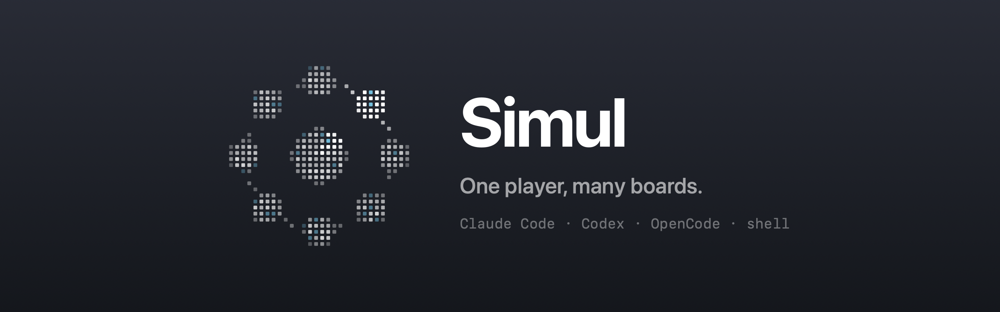

# Simul

**One player, many boards.** A native macOS app for running several coding
agents side by side — Claude Code, Codex, OpenCode or a plain shell — each in
a real terminal, one keystroke apart (`⌘1`…`⌘9`).

Named after a chess *simul*, where one player walks between many boards and
plays wherever a move is waiting. [simul.sh](https://simul.sh)

- **Real terminals.** Every session is a [Ghostty](https://ghostty.org)
  terminal running the agent's own CLI, with your login, config and MCPs —
  Simul never talks to provider APIs or touches credentials.
- **Picks up where you left off.** Each session reopens its own conversation.
- **Knows what needs you.** Sessions show when an agent is working and when
  it's done; plan limits for Claude and Codex sit at the bottom.

Early and personal: macOS 14+, Apple Silicon. [FEATURES.md](FEATURES.md) lists
everything it does; [CHANGELOG.md](CHANGELOG.md) what changed when.

## Building

Needs the Command Line Tools (no Xcode) and Zig 0.16.0, the exact version the
pinned Ghostty expects:

```sh
git submodule update --init Vendor/Ghostty
curl -fsSL https://ziglang.org/download/0.16.0/zig-aarch64-macos-0.16.0.tar.xz | tar xJ -C Vendor
mv Vendor/zig-aarch64-macos-0.16.0 Vendor/zig

scripts/build-ghostty.sh   # builds libghostty.a (a few minutes, once)
scripts/build-app.sh       # builds Build/Simul.app, then runs scripts/smoke.sh
scripts/install.sh         # optional: copies it to /Applications and opens it
swift run SimulTests       # tests (tmux tests need `brew install tmux`)
```

## License

[MIT](LICENSE) © Bernat Torres.

Simul builds on [Ghostty](https://github.com/ghostty-org/ghostty) (MIT,
© Mitchell Hashimoto and Ghostty contributors), included as a submodule and
linked into the app; its license ships with it and must accompany any
distributed build.

Claude, Codex/OpenAI and OpenCode names and logos are trademarks of their
respective owners, used only to show which agent a session runs. Simul is not
affiliated with or endorsed by them.
